# Crate graph

<!-- Generated by `cargo xtask gen-docs`. Do not edit: run it and commit the result. -->

The workspace crates by layer, from `cargo metadata` and each crate's `[package.metadata.pos]` card. An arrow points from a crate to a workspace crate it uses outside tests. Dependencies only tests use are in the table.

```mermaid
flowchart LR
  subgraph core
    pos_core["pos-core"]
    pos_proto["pos-proto"]
  end
  subgraph port
    pos_ports["pos-ports"]
    pos_providers["pos-providers"]
  end
  subgraph adapter
    blob_garage["blob-garage"]
    cloud_sync_http["cloud-sync-http"]
    erp_sap["erp-sap"]
    key_vault_keyring["key-vault-keyring"]
    link_nats["link-nats"]
    metrics_vm["metrics-vm"]
    printer_escpos["printer-escpos"]
    shipping_ahamove["shipping-ahamove"]
    shipping_grabexpress["shipping-grabexpress"]
    store_postgres["store-postgres"]
    store_sqlite["store-sqlite"]
    updater_minisign["updater-minisign"]
    windows_protect["windows-protect"]
  end
  subgraph app
    pos_cloud["pos-cloud"]
    pos_cloud_api["pos-cloud-api"]
    pos_cloud_reports["pos-cloud-reports"]
    pos_edge["pos-edge"]
    pos_print_agent["pos-print-agent"]
    pos_render["pos-render"]
    minimal_edge["minimal-edge"]
  end
  subgraph testing
    pos_contract_tests["pos-contract-tests"]
    pos_fakes["pos-fakes"]
    pos_simulator["pos-simulator"]
  end
  subgraph tool
    xtask["xtask"]
  end
  subgraph country
    pos_country_in["pos-country-in"]
    pos_country_jp["pos-country-jp"]
    pos_country_vn["pos-country-vn"]
    pos_country_zz["pos-country-zz"]
    pos_country["pos-country"]
  end
  blob_garage --> pos_ports
  cloud_sync_http --> pos_ports
  cloud_sync_http --> pos_proto
  erp_sap --> pos_ports
  erp_sap --> pos_proto
  erp_sap --> pos_providers
  key_vault_keyring --> pos_ports
  key_vault_keyring --> windows_protect
  link_nats --> pos_ports
  link_nats --> pos_proto
  metrics_vm --> pos_ports
  metrics_vm --> pos_proto
  minimal_edge --> pos_edge
  minimal_edge --> pos_fakes
  minimal_edge --> pos_proto
  pos_cloud --> blob_garage
  pos_cloud --> erp_sap
  pos_cloud --> link_nats
  pos_cloud --> metrics_vm
  pos_cloud --> pos_cloud_api
  pos_cloud --> pos_cloud_reports
  pos_cloud --> pos_core
  pos_cloud --> pos_country
  pos_cloud --> pos_country_in
  pos_cloud --> pos_country_jp
  pos_cloud --> pos_country_vn
  pos_cloud --> pos_country_zz
  pos_cloud --> pos_ports
  pos_cloud --> pos_proto
  pos_cloud --> pos_providers
  pos_cloud --> shipping_ahamove
  pos_cloud --> shipping_grabexpress
  pos_cloud --> store_postgres
  pos_cloud_api --> pos_ports
  pos_cloud_api --> pos_proto
  pos_cloud_api --> store_postgres
  pos_cloud_reports --> pos_cloud_api
  pos_cloud_reports --> pos_ports
  pos_cloud_reports --> pos_proto
  pos_cloud_reports --> store_postgres
  pos_contract_tests --> pos_ports
  pos_contract_tests --> pos_proto
  pos_core --> pos_proto
  pos_country --> pos_ports
  pos_country --> pos_proto
  pos_country_in --> pos_country
  pos_country_in --> pos_ports
  pos_country_in --> pos_proto
  pos_country_jp --> pos_country
  pos_country_jp --> pos_ports
  pos_country_jp --> pos_proto
  pos_country_vn --> pos_country
  pos_country_vn --> pos_ports
  pos_country_vn --> pos_proto
  pos_country_zz --> pos_country
  pos_country_zz --> pos_ports
  pos_country_zz --> pos_proto
  pos_edge --> cloud_sync_http
  pos_edge --> key_vault_keyring
  pos_edge --> link_nats
  pos_edge --> pos_core
  pos_edge --> pos_country
  pos_edge --> pos_country_in
  pos_edge --> pos_country_jp
  pos_edge --> pos_country_vn
  pos_edge --> pos_country_zz
  pos_edge --> pos_ports
  pos_edge --> pos_proto
  pos_edge --> pos_render
  pos_edge --> printer_escpos
  pos_edge --> store_sqlite
  pos_edge --> updater_minisign
  pos_edge --> windows_protect
  pos_fakes --> pos_contract_tests
  pos_fakes --> pos_ports
  pos_fakes --> pos_proto
  pos_ports --> pos_proto
  pos_print_agent --> pos_ports
  pos_print_agent --> pos_proto
  pos_print_agent --> printer_escpos
  pos_providers --> pos_proto
  pos_render --> pos_ports
  pos_simulator --> pos_core
  printer_escpos --> pos_ports
  printer_escpos --> pos_proto
  shipping_ahamove --> pos_ports
  shipping_ahamove --> pos_proto
  shipping_ahamove --> pos_providers
  shipping_grabexpress --> pos_ports
  shipping_grabexpress --> pos_proto
  shipping_grabexpress --> pos_providers
  store_postgres --> pos_ports
  store_postgres --> pos_proto
  store_sqlite --> pos_ports
  store_sqlite --> pos_proto
  updater_minisign --> pos_ports
```

| Crate | Layer | Path | Purpose | Used by | Used in tests by |
|---|---|---|---|---|---|
| `blob-garage` | adapter | `crates/adapters/blob-garage` | The cloud BlobStore over Garage/S3, with hand-rolled SigV4 and HTTP and no S3 SDK. | `pos-cloud` | — |
| `cloud-sync-http` | adapter | `crates/adapters/cloud-sync-http` | The edge's CloudSync and MessageLink over HTTPS to the cloud: activation, OTA fetch, and event delivery. | `pos-edge` | — |
| `erp-sap` | adapter | `crates/adapters/erp-sap` | The SAP ErpSink adapter: nightly whole-day revenue and consumption posting over HTTPS. | `pos-cloud` | — |
| `key-vault-keyring` | adapter | `crates/adapters/key-vault-keyring` | The edge's KeyVault: device credentials in the OS credential store, sealed under a systemd-creds key on Linux and a DPAPI key on Windows. | `pos-edge` | — |
| `link-nats` | adapter | `crates/adapters/link-nats` | The store-to-cloud MessageLink over NATS JetStream, and the cloud's consumer of it. | `pos-cloud`, `pos-edge` | — |
| `metrics-vm` | adapter | `crates/adapters/metrics-vm` | The cloud MetricsSink over VictoriaMetrics: bounded queue, background flush, hand-rolled HTTP import. | `pos-cloud` | — |
| `minimal-edge` | app | `examples/minimal-edge` | The smallest runnable store: pos_edge on the in-memory fakes, with no database, hardware or network. | — | — |
| `pos-cloud` | app | `crates/pos-cloud` | The cloud binary, pos_cloud: event ingest, rollups, configuration, the /v1 API and the /admin console API. | — | — |
| `pos-cloud-api` | app | `crates/pos-cloud-api` | The base every cloud route module stands on: console sessions and permissions, API keys, the audit trail, paging and the error envelope. | `pos-cloud`, `pos-cloud-reports` | — |
| `pos-cloud-reports` | app | `crates/pos-cloud-reports` | The cloud's reports: rollups folded from the event log and materialised, revenue, the X/Z report, their CSV exports and their routes. | `pos-cloud` | — |
| `pos-contract-tests` | testing | `crates/pos-contract-tests` | The shared suite every implementation of every port must pass. | `pos-fakes` | `blob-garage`, `cloud-sync-http`, `erp-sap`, `key-vault-keyring`, `link-nats`, `metrics-vm`, `pos-cloud`, `pos-cloud-reports`, `pos-country-in`, `pos-country-jp`, `pos-country-vn`, `pos-country-zz`, `pos-edge`, `printer-escpos`, `shipping-ahamove`, `shipping-grabexpress`, `store-postgres`, `store-sqlite`, `updater-minisign` |
| `pos-core` | core | `crates/pos-core` | The domain: business rules, state machines, permissions and money arithmetic, with no I/O. | `pos-cloud`, `pos-edge`, `pos-simulator` | — |
| `pos-country` | country | `crates/pos-country` | What a country module is, and the feature-selected registry a binary builds from the ones it carries. | `pos-cloud`, `pos-country-in`, `pos-country-jp`, `pos-country-vn`, `pos-country-zz`, `pos-edge` | — |
| `pos-country-in` | country | `countries/in` | The country module for India. | `pos-cloud`, `pos-edge` | — |
| `pos-country-jp` | country | `countries/jp` | The country module for Japan. | `pos-cloud`, `pos-edge` | — |
| `pos-country-vn` | country | `countries/vn` | The country module for Vietnam. | `pos-cloud`, `pos-edge` | — |
| `pos-country-zz` | country | `countries/zz` | The reference country module, copied to start a new country. | `pos-cloud`, `pos-edge` | — |
| `pos-edge` | app | `crates/pos-edge` | The store binary, pos_edge: serves the till, applies each decision in one transaction, and syncs with the cloud. | `minimal-edge` | — |
| `pos-fakes` | testing | `crates/pos-fakes` | In-memory implementations of every port, held to the same contract suites as the real adapters. | `minimal-edge` | `key-vault-keyring`, `pos-cloud`, `pos-cloud-api`, `pos-cloud-reports`, `pos-country-in`, `pos-country-jp`, `pos-country-vn`, `pos-country-zz`, `pos-edge`, `printer-escpos`, `store-sqlite`, `updater-minisign` |
| `pos-ports` | port | `crates/pos-ports` | The twenty traits between the framework and the outside world. | `blob-garage`, `cloud-sync-http`, `erp-sap`, `key-vault-keyring`, `link-nats`, `metrics-vm`, `pos-cloud`, `pos-cloud-api`, `pos-cloud-reports`, `pos-contract-tests`, `pos-country`, `pos-country-in`, `pos-country-jp`, `pos-country-vn`, `pos-country-zz`, `pos-edge`, `pos-fakes`, `pos-print-agent`, `pos-render`, `printer-escpos`, `shipping-ahamove`, `shipping-grabexpress`, `store-postgres`, `store-sqlite`, `updater-minisign` | — |
| `pos-print-agent` | app | `crates/pos-print-agent` | The print agent: claims rendered jobs from a store's edge and writes them to a printer this machine reaches. | — | — |
| `pos-proto` | core | `crates/pos-proto` | Wire types, the event catalogue and envelope, value types, and PROTOCOL_VERSION. | `cloud-sync-http`, `erp-sap`, `link-nats`, `metrics-vm`, `minimal-edge`, `pos-cloud`, `pos-cloud-api`, `pos-cloud-reports`, `pos-contract-tests`, `pos-core`, `pos-country`, `pos-country-in`, `pos-country-jp`, `pos-country-vn`, `pos-country-zz`, `pos-edge`, `pos-fakes`, `pos-ports`, `pos-print-agent`, `pos-providers`, `printer-escpos`, `shipping-ahamove`, `shipping-grabexpress`, `store-postgres`, `store-sqlite` | — |
| `pos-providers` | port | `crates/pos-providers` | The vendor catalogue: the descriptor each vendor adapter exports, and the registry built from them. | `erp-sap`, `pos-cloud`, `shipping-ahamove`, `shipping-grabexpress` | — |
| `pos-render` | app | `crates/pos-render` | Turns a line of text in any script into the 1-bit raster a thermal printer prints. | `pos-edge` | — |
| `pos-simulator` | testing | `crates/pos-simulator` | The virtual-fleet simulator: an executable capacity model and deterministic fleet scenarios. | — | — |
| `printer-escpos` | adapter | `crates/adapters/printer-escpos` | The ESC/POS thermal-printer adapter for the PrinterDriver port. | `pos-edge`, `pos-print-agent` | — |
| `shipping-ahamove` | adapter | `crates/adapters/shipping-ahamove` | The Ahamove ShippingDispatch adapter: book, cancel and track a courier job over HTTPS. | `pos-cloud` | — |
| `shipping-grabexpress` | adapter | `crates/adapters/shipping-grabexpress` | The Grab Express ShippingDispatch adapter: book, cancel and track a courier job over HTTPS. | `pos-cloud` | — |
| `store-postgres` | adapter | `crates/adapters/store-postgres` | The cloud EventStore and the cloud's own stores over PostgreSQL (tokio-postgres, deadpool, monthly partitions, RLS). | `pos-cloud`, `pos-cloud-api`, `pos-cloud-reports` | — |
| `store-sqlite` | adapter | `crates/adapters/store-sqlite` | The edge store over SQLite: event, config, device, subject and intake stores on one single-writer thread. | `pos-edge` | — |
| `updater-minisign` | adapter | `crates/adapters/updater-minisign` | The minisign Signer for over-the-air updates: verify only. | `pos-edge` | — |
| `windows-protect` | adapter | `crates/adapters/windows-protect` | Windows' own protection for a store box's state: DPAPI for the vault key, and who may read the state directory. | `key-vault-keyring`, `pos-edge` | — |
| `xtask` | tool | `xtask` | Repository checks run by just preflight and CI: dependency rule, snapshots, migrations, links, changelog, code size. | — | — |
